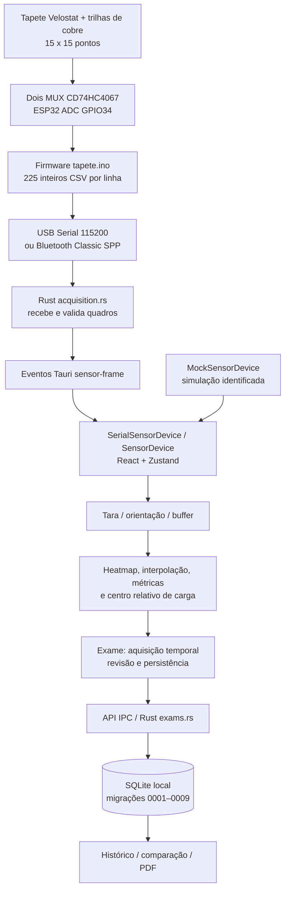

# BAROPRESS — mapa completo do projeto e de sua evolução

> **Levantamento de 26/10/2026.** Documento central para navegar pelo acervo histórico, hardware, firmware, código desktop, dados, testes e documentação do TCC. Referência de trabalho: BAROPRESS `0.2.15`, branch de documentação `codex/documentacao-historica-20261026`. Consulte também o [inventário navegável dos arquivos versionados](historia/MANIFESTO_ARQUIVOS_VERSIONADOS.md), que enumera cada caminho rastreado pelo Git. Um inventário de arquivos **não equivale** a uma auditoria funcional individual.

## 1. Ponto de partida: o que foi encontrado e o que foi preservado

O diretório histórico original é `C:\Users\Montival Nunes\Desktop\teste arduino\`. O **repositório atual** está em `NOVO PROGRAMA/baropress-fase1/baropress/` dentro dessa pasta. A origem do projeto precede o primeiro commit Git disponível (`25968fe`, de 20/10/2026). A cronologia anterior foi **reconstituída a partir de código e registros**, sem inventar commits ou datas para os protótipos.

| Etapa | Evidência principal | O que mudou |
| --- | --- | --- |
| Tapete experimental | [montagem](../hardware/README.md), [matriz](../hardware/MATRIZ_SENSORES.md), [pinagem](../hardware/PINAGEM_ESP32.md) | Malha de Velostat e cobre com 15 × 15 posições sensíveis; varredura elétrica multiplexada. |
| Aquisição embarcada | [código original `tapete.ino`](../firmware/esp32/tapete.ino), [protocolo](../firmware/esp32/PROTOCOLO_COMUNICACAO.md) | ESP32 lê 225 pontos e transmite linhas CSV por USB serial e Bluetooth Classic SPP. |
| Python inicial | [`heatmap_inicial.py`](../prototipos/python-heatmap/heatmap_inicial.py) | Recepção serial, matriz, espelhamento, baseline pelo **máximo** de 30 quadros e limiar fixo de 180 ADC. |
| Python interativo | [`heatmap_interativo.py`](../prototipos/python-heatmap/heatmap_interativo.py) | Baseline pela **média** de 30 quadros, botão de tara e ajustes de visualização/limiar. |
| BAROPRESS desktop | [`src/App.tsx`](../src/App.tsx), [`src-tauri/src/lib.rs`](../src-tauri/src/lib.rs), [`db.rs`](../src-tauri/src/db.rs) | UI React, comandos Rust/Tauri, SQLite local, pacientes, exames, análises e relatórios. |
| Evolução documentada em outubro | [`Sprint/05_Historico`](../Sprint/05_Historico/), [linha do tempo](historia/LINHA_DO_TEMPO.md) | Comparação, agenda, questionários, backup, calibração, acesso, análises e revisões de UX. |

A cópia histórica `mapa_calor.py` tinha conteúdo idêntico a `heatmap.py`, segundo os hashes preservados. `iniciar_mapa.bat` foi arquivado como [`iniciar_mapa_original.bat`](../prototipos/python-heatmap/iniciar_mapa_original.bat); ele ainda menciona o **nome antigo** do script. Os arquivos originais continuam no acervo externo. Nomes como “inicial” e “interativo” representam a sequência técnica inferida, e não datas de produção comprovadas. Consulte [origens, nomes e SHA-256](historia/ORIGENS_E_INTEGRIDADE.md).

## 2. Mapa das pastas dentro do repositório

```text
baropress/                             ← raiz Git, aplicativo desktop
├── README.md                          ← apresentação, módulos e execução
├── docs/                              ← mapa, arquitetura, evidências, validação
│   ├── MAPEAMENTO_COMPLETO_PROJETO.md ← este guia
│   ├── historia/                      ← cronologia, origens, manifesto e GitHub
│   ├── algoritmos/                    ← matemática, aquisição e processamento
│   ├── validacao/                     ← ensaios, limites e verificações
│   ├── audit/, review/, corrections/  ← diagnósticos e correções por versão
│   ├── barosys/                       ← estudos, plano e verificações comparativas
│   ├── maintenance/, performance/     ← organização, medições e otimização
│   └── questionnaires/, referencias/ ← anamnese e referências autorizadas
├── prototipos/python-heatmap/         ← fontes Python históricos e instruções
├── firmware/esp32/                    ← sketch original e protocolo CSV
├── hardware/                          ← componentes, montagem, pinagem e imagens
├── src/                               ← frontend React/TypeScript
│   ├── App.tsx, main.tsx              ← shell, autenticação e navegação
│   ├── features/                      ← fluxos de negócio e telas
│   ├── services/                      ← aquisição, cálculos e IPC
│   ├── stores/                        ← estados locais Zustand
│   ├── components/, pages/            ← peças comuns e páginas
│   ├── types/                         ← contratos TypeScript
│   └── tests/                         ← testes Vitest
├── src-tauri/                         ← backend Rust e empacotamento desktop
│   ├── src/                           ← comandos, autenticação, serial, banco
│   ├── migrations/                    ← versões SQL 0001 a 0009
│   ├── capabilities/, icons/          ← permissões e ícones
│   └── Cargo.toml, tauri.conf.json    ← dependências e configuração
├── scripts/                           ← checagens, benchmarks e prévias
├── Sprint/                            ← plano acadêmico, histórico e entregáveis
├── baropress-liquid-glass/            ← experimento visual independente
└── arquivos de configuração           ← package*.json, Vite, TS, Tailwind, Git
```

Pastas como `node_modules/`, `dist/`, `src-tauri/target/`, `src-tauri/gen/` e caches são produtos de dependências/build. A área [`Sprint/Documentacao_TCC/`](../Sprint/Documentacao_TCC/) contém entregas e previews; [`Sprint/05_Historico/`](../Sprint/05_Historico/) reúne relatos datados. Parte de `entrega/` e `.evento-build/` pode existir no workspace local como material de distribuição e eventos: confirmar rastreamento no [manifesto](historia/MANIFESTO_ARQUIVOS_VERSIONADOS.md) antes de presumir que está no GitHub. O protótipo [`baropress-liquid-glass/`](../baropress-liquid-glass/) é separado da UI do app.

## 3. Fluxo técnico: do pé ao exame armazenado



O firmware histórico amostra cada célula e transmite `v[0],v[1],...,v[224]\n` em **ordem linha-coluna**, sem cabeçalho de quadro, timestamp, checksum nem número sequencial. O parser Rust [`parse_csv_frame`](../src-tauri/src/acquisition.rs) exige 225 números inteiros de `0` a `4095`, e o programa ignora quadros inválidos; existe também [`parser.ts`](../src/services/acquisition/parser.ts) na camada TypeScript. O evento Rust `sensor-frame` chega à implementação [`SerialSensorDevice`](../src/services/acquisition/SerialSensorDevice.ts). A abstração [`SensorDevice`](../src/services/acquisition/SensorDevice.ts) permite simulação por [`MockSensorDevice`](../src/services/acquisition/MockSensorDevice.ts). [Protocolo detalhado](../firmware/esp32/PROTOCOLO_COMUNICACAO.md).

Os caminhos de aquisição, tara, renderização e exame são separados: **FPS de interface não prova taxa física de amostragem**. A normalização/espelhamento deve ser conferida com o tapete real para estabelecer esquerda/direita anatômicas. Grandezas derivadas do ADC são **relativas**; nenhuma pressão clínica em unidade física, exatidão metrológica ou aptidão diagnóstica é afirmada pelo código e por este mapa. Ver [limitações](validacao/LIMITACOES.md), [ensaios](validacao/ENSAIOS.md) e [baropodometria](BAROPODOMETRY.md).

## 4. Responsabilidades do frontend (`src/`)

| Arquivo ou diretório | Função / dependência principal |
| --- | --- |
| [`main.tsx`](../src/main.tsx), [`App.tsx`](../src/App.tsx) | Inicialização React, verificação de sessão, permissões, navegação e lazy loading das telas. |
| [`components/`](../src/components/), [`pages/`](../src/pages/) | Sidebar, alertas/erros, proteção de navegação, Dashboard e Configurações. |
| [`features/auth/`](../src/features/auth/), [`features/patients/`](../src/features/patients/) | Login, usuários/perfis; cadastro, edição, arquivamento e prontuário de pacientes. |
| [`features/acquisition/`](../src/features/acquisition/), [`pages/Settings.tsx`](../src/pages/Settings.tsx) | Controles de dispositivo e ajustes; o Arduino é acessado em Configurações. |
| [`features/baropodometry/`](../src/features/baropodometry/) | Painel de leitura e mapa de calor em tempo de execução. |
| [`features/calibration/`](../src/features/calibration/) | Assistentes, ensaios, perfis e consultas de calibração. |
| [`features/exams/`](../src/features/exams/) | Novo exame, ciclo de aquisição, revisão, histórico e detalhes; algumas alterações locais em 26/10 estavam **em desenvolvimento**, ainda fora do commit de documentação. |
| [`services/examAnalysis/`](../src/services/examAnalysis/), [`features/comparison/`](../src/features/comparison/) | Processamento analítico e comparação entre exames. |
| [`features/reports/`](../src/features/reports/) | Prévia e emissão de documentos; inclui [`reportPdfGenerator.ts`](../src/features/reports/reportPdfGenerator.ts). |
| [`features/agenda/`](../src/features/agenda/), [`features/questionnaires/`](../src/features/questionnaires/) | Agendamento e aplicação/histórico de questionários. |
| [`features/backup/`](../src/features/backup/), [`features/logs/`](../src/features/logs/) | Exportação/restauração e acompanhamento de logs. |
| [`services/acquisition/`](../src/services/acquisition/) | Dispositivo real/simulado, parser, conexão automática, buffer, stream e tara. |
| [`services/baropodometry/`](../src/services/baropodometry/) | Heatmap, interpolação, ajustes, normalização, indicadores e trajetórias. |
| [`services/calibration/`](../src/services/calibration/), [`services/examAnalysis/`](../src/services/examAnalysis/) | Processamento de calibração e resultados analíticos. |
| [`services/examProtocol.ts`](../src/services/examProtocol.ts), [`services/database/api.ts`](../src/services/database/api.ts) | Regras do protocolo de exame e fronteira de chamadas `invoke` Tauri; cache/invalidação de leituras. |
| [`stores/`](../src/stores/), [`types/`](../src/types/), [`tests/`](../src/tests/) | Estado compartilhado, contratos e suíte automatizada. |

**Regra de leitura:** um diretório/arquivo listado informa sua responsabilidade pelo nome e pelo código identificado; isso **não garante** que toda função esteja ativa na interface de produção. O frontend chama o backend principalmente por [`services/database/api.ts`](../src/services/database/api.ts), enquanto aquisição usa também comandos/eventos Tauri por [`SerialSensorDevice.ts`](../src/services/acquisition/SerialSensorDevice.ts).

## 5. Backend (`src-tauri/src/`), comandos e isolamento

| Módulo Rust | Responsabilidade |
| --- | --- |
| [`main.rs`](../src-tauri/src/main.rs), [`lib.rs`](../src-tauri/src/lib.rs) | Inicialização Tauri, montagem de estado e despacho dos comandos IPC. |
| [`command_queue.rs`](../src-tauri/src/command_queue.rs) | Filas separadas de comandos serial e demais comandos, com execução fora da janela. |
| [`acquisition.rs`](../src-tauri/src/acquisition.rs) | Enumeração/conexão serial, leitura, validação de CSV 15×15, status, eventos e contadores. |
| [`db.rs`](../src-tauri/src/db.rs) | Abertura SQLite, migrações transacionais, cópia de banco legado e snapshot antes de atualização. |
| [`auth.rs`](../src-tauri/src/auth.rs), [`permissions.rs`](../src-tauri/src/permissions.rs), [`users.rs`](../src-tauri/src/users.rs) | Sessão, autorização de chamadas e administração de usuários. |
| [`patients.rs`](../src-tauri/src/patients.rs), [`exams.rs`](../src-tauri/src/exams.rs) | Pacientes, exames, quadros, consulta, salvamento e revisões. |
| [`exam_analysis.rs`](../src-tauri/src/exam_analysis.rs), [`calibration.rs`](../src-tauri/src/calibration.rs) | Análise de exame e perfis/ensaios de calibração. |
| [`agenda.rs`](../src-tauri/src/agenda.rs), [`questionnaires.rs`](../src-tauri/src/questionnaires.rs) | Agendamentos, profissionais e questionários. |
| [`backup.rs`](../src-tauri/src/backup.rs), [`support.rs`](../src-tauri/src/support.rs), [`pagination.rs`](../src-tauri/src/pagination.rs) | Backup, logs, funções auxiliares e paginação. |
| [`*_tests.rs`](../src-tauri/src/) | Testes Rust próximos ao código, complementados por testes internos aos módulos. |

Em [`lib.rs`](../src-tauri/src/lib.rs), `dispatch_command` faz autorização antes de despachar operações, inclusive logs de determinadas solicitações. O código não depende de um servidor externo de banco para os fluxos principais; SQLite reside no computador do operador. A existência de controle de acesso implementado **não substitui** revisão de segurança, backup e configuração do dispositivo.

## 6. Mapa do banco de dados e suas nove migrações

As migrações são aplicadas em sequência por [`db.rs`](../src-tauri/src/db.rs), com `PRAGMA user_version` e transações. **Não editar, excluir nem renumerar migrações já publicadas.** Um banco migrado para esquema mais recente pode ser incompatível com binários antigos; antes de atualização use cópia segura e um banco de homologação.

| Migração SQL | Estruturas introduzidas / mudança principal |
| --- | --- |
| [`0001_init`](../src-tauri/migrations/0001_init.sql) | `users`, `clinics`, `professionals`, `patients`, `appointments`, `questionnaires`, `questionnaire_questions`, `questionnaire_answers`, `exams`, `exam_frames`, `exam_metrics`, `reports`, `settings`, `system_logs`. |
| [`0002_exams_phase5`](../src-tauri/migrations/0002_exams_phase5.sql) | Colunas de métricas relativas, dados de matriz e configurações do exame, índice temporal. |
| [`0003_exam_visualization`](../src-tauri/migrations/0003_exam_visualization.sql) | JSON com preferências de visualização do exame. |
| [`0004_exam_trajectory`](../src-tauri/migrations/0004_exam_trajectory.sql) | Trajetória relativa registrada para exame. |
| [`0005_questionnaire_sessions`](../src-tauri/migrations/0005_questionnaire_sessions.sql) | Sessões de questionários, grupos e relação com respostas. |
| [`0006_calibration`](../src-tauri/migrations/0006_calibration.sql) | Tapetes, ensaios, chunks, perfis, validações e calibração ativa; resultados físicos e chunks brutos de exame. |
| [`0007_exam_patient_snapshot`](../src-tauri/migrations/0007_exam_patient_snapshot.sql) | Snapshot dos dados do paciente associados ao exame. |
| [`0008_exam_analysis`](../src-tauri/migrations/0008_exam_analysis.sql) | JSON de análise do exame. |
| [`0009_user_access`](../src-tauri/migrations/0009_user_access.sql) | RA, exclusão lógica e versão de sessão de usuários. |

O desenho SQL permite tanto matriz resumida/indicadores quanto estruturas para quadros brutos. A estratégia efetivamente utilizada depende da versão e do caminho de gravação em [`exams.rs`](../src-tauri/src/exams.rs); não presumir que todo exame histórico contenha dados brutos suficientes para reproduzir análises novas. Os dados de pessoas e exames não são artefatos adequados para um repositório Git público.

## 7. Scripts, verificações, configurações e publicação

| Grupo | Onde olhar / para que serve |
| --- | --- |
| Dependências e comandos | [`package.json`](../package.json): `npm run typecheck`, `npm test`, `npm run build`, `npm run tauri:dev` e `npm run tauri:build`. |
| Configuração desktop | [`src-tauri/Cargo.toml`](../src-tauri/Cargo.toml), [`src-tauri/tauri.conf.json`](../src-tauri/tauri.conf.json), capabilities e ícones; instalador Windows documentado em [`BUILD_WINDOWS.md`](BUILD_WINDOWS.md). |
| Checagem estrutural | [`scripts/check_project.cjs`](../scripts/check_project.cjs), [`scripts/audit_inventory.cjs`](../scripts/audit_inventory.cjs) e [`scripts/audit_verify.ps1`](../scripts/audit_verify.ps1). |
| Benchmark / visualização | [`scripts/`](../scripts/) contém benchmarks de interpolação/BaroSys e prévias de aquisição, calibração, usuários e análise; parte usa fixtures sintéticas. |
| Documentação atualizável | [`scripts/gerar_manifesto_arquivos.py`](../scripts/gerar_manifesto_arquivos.py) regenera o [manifesto de arquivos versionados](historia/MANIFESTO_ARQUIVOS_VERSIONADOS.md). |
| Testes frontend | [`src/tests/`](../src/tests/): Vitest por domínio, inclusive serial, permissões, cache, exames, calibração e relatórios. |
| Testes backend | [`src-tauri/src/`](../src-tauri/src/): testes Rust internos e arquivos dedicados de fluxo/análise/autenticação. |
| Verificações registradas | [26/10/2026](validacao/VERIFICACOES_2026-10-26.md): TypeScript, Vitest, build web, Python e script de inspeção aprovados naquele contexto; Rust impedido por linker ausente. |

Comandos sugeridos para a **próxima execução controlada** na raiz do projeto:

```powershell
python scripts/gerar_manifesto_arquivos.py
git diff -- docs/MAPEAMENTO_COMPLETO_PROJETO.md docs/historia/MANIFESTO_ARQUIVOS_VERSIONADOS.md
npm run typecheck
npm test
npm run build
node scripts/check_project.cjs
```

Não executar builds sobre diretórios de entrega existentes sem revisar entradas/saídas. O manifesto usa **somente caminhos rastreados pelo índice Git**, incluindo arquivos já staged, para evitar documentar acidentalmente os arquivos privados e as alterações locais não rastreadas.

## 8. Índice de documentação e evidências

| Pergunta | Documento que responde |
| --- | --- |
| O que aconteceu primeiro? | [Linha do tempo](historia/LINHA_DO_TEMPO.md), [evolução técnica](historia/EVOLUCAO_TECNICA.md) e [decisões](historia/DECISOES_DE_PROJETO.md). |
| Onde vieram os fontes antigos? | [Proveniência e SHA-256](historia/ORIGENS_E_INTEGRIDADE.md), [inventário dos diretórios externos](historia/INVENTARIO_DIRETORIOS.md). |
| Como obter os 225 dados? | [Aquisição](algoritmos/AQUISICAO_DADOS.md) e [protocolo original](../firmware/esp32/PROTOCOLO_COMUNICACAO.md). |
| Como surgem os mapas e indicadores? | [Processamento Python](algoritmos/PROCESSAMENTO_PYTHON.md), [documentação baropodométrica](BAROPODOMETRY.md), [arquitetura](ARCHITECTURE.md). |
| Que resultados de teste podem ser citados? | [Ensaios](validacao/ENSAIOS.md), [limitações](validacao/LIMITACOES.md), [verificações de software](validacao/VERIFICACOES_2026-10-26.md). |
| O que foi planejado/feito em cada período? | [`Sprint/`](../Sprint/), [`Sprint/05_Historico/`](../Sprint/05_Historico/), [`Sprint/Documentacao_TCC/`](../Sprint/Documentacao_TCC/). |
| Onde estão relatórios de problemas/decisões? | [`docs/audit/`](audit/), [`docs/review/`](review/), [`docs/corrections/`](corrections/), [`docs/maintenance/`](maintenance/). |
| Como manter a documentação e publicar? | [Guia GitHub](historia/GUIA_GITHUB.md), [organização](maintenance/ORGANIZACAO.md) e [manifesto completo](historia/MANIFESTO_ARQUIVOS_VERSIONADOS.md). |

O material de [`Sprint/Documentacao_TCC/`](../Sprint/Documentacao_TCC/) inclui textos, geração de documentos, PDF, imagens de prévia e registros de bancada. Imagens e medições relatadas em documentos históricos requerem confirmação de contexto e origem antes de servirem como prova de validação clínica. Documentos antigos podem descrever interfaces, contagens ou performance de versões anteriores: verifique o commit e a data.

## 9. Mapa do acervo **fora** do repositório

Os caminhos abaixo são **relativos ao diretório `teste arduino/`**, não links publicáveis no GitHub. O inventário cobre grupos identificados em 26/10/2026 e **não afirma análise individual de cada arquivo externo**.

| Origem local | Estado / regra |
| --- | --- |
| `heatmap_backup.py`, `heatmap.py`, `mapa_calor.py`, `iniciar_mapa.bat` | Originais preservados localmente; equivalentes históricos já incorporados em [`prototipos/python-heatmap/`](../prototipos/python-heatmap/), com duplicata identificada por hash. |
| `tapete/tapete.ino` | Original preservado; cópia verificada em [`firmware/esp32/`](../firmware/esp32/). |
| `Contexto.txt`, `PROJETO TCC - FASES.txt` | Fontes de planejamento referenciadas em [`Sprint/01_Referencias/`](../Sprint/01_Referencias/). |
| `NOVO PROGRAMA/baropress-fase1/baropress/` | Código principal e repositório versionado (este projeto). |
| `NOVO PROGRAMA/baropress-fase1/baropress-mac-m4/` | Adaptação independente da 0.2.14 e material macOS; **comparar diferenças** antes de importar. Build nativo precisa de validação no Mac. |
| `NOVO PROGRAMA/imagens testes programa/` | 92 capturas, mantidas locais; selecionar, obter autorização e anonimizar antes de publicar. |
| `Baroscan/`, `ManualBaroScanv1.12.pdf` | Manual e arquivos comerciais de terceiros para consulta; **não redistribuir**. |
| `_backup_documentacao_2026-10-26/` | Backup e diffs do levantamento; manter fora do Git e sob guarda. |
| `__pycache__/`, dependências, executáveis e builds | Derivados técnicos; não incorporar recursivamente. |

Não publicar bancos `.db`, imagens identificáveis, CPF/nome de paciente, tokens, credenciais, instaladores de terceiros ou backups privados. Fotografias e dados de ensaios próprios devem ser revisados antes de publicação pública. Ver [critérios de organização](historia/INVENTARIO_DIRETORIOS.md) e [guia de GitHub](historia/GUIA_GITHUB.md).

## 10. Situação de versionamento e procedimentos de atualização

- O primeiro commit Git disponível (`25968fe`) corresponde a um estado já desenvolvido em **20/10/2026**, não ao nascimento do firmware/Python.
- A branch `codex/documentacao-historica-20261026` guarda a reconstrução histórica (`59c6a26`) e suas atualizações documentais posteriores. A integração na `main` deve ocorrer após revisão do PR.
- Em 26/10/2026 havia alterações locais **não commitadas** em `src/`, `src-tauri/`, `package*.json`, além de revisões e scripts novos. São trabalho em andamento e **não fazem parte do commit histórico**. O manifesto cobre apenas caminhos rastreados; o código local pode divergir do último commit publicado.
- Para um novo marco, adicionar evidências com data, versão e identificação da origem; atualizar [linha do tempo](historia/LINHA_DO_TEMPO.md), [decisões](historia/DECISOES_DE_PROJETO.md), este mapa, manifesto e [validação](validacao/ENSAIOS.md).
- Antes de atualizar no GitHub, usar `git status --short`, inspecionar `git diff`, executar validações pertinentes e fazer `git add` **apenas dos caminhos aprovados**. Revisar `git diff --cached --name-only` e `git diff --cached --check` antes de commitar. Não incluir inadvertidamente trabalho em andamento com `git add .`.

**Pendências de pesquisa e validação:** medir e registrar a taxa real de aquisição, topologia elétrica completa e montagem, orientação anatômica, exatidão de calibração, precisão/repetibilidade, compatibilidade do pacote macOS e autorização de imagens. Sem essas provas, conclusões clínicas ou comparações de desempenho quantitativas seriam prematuras.
