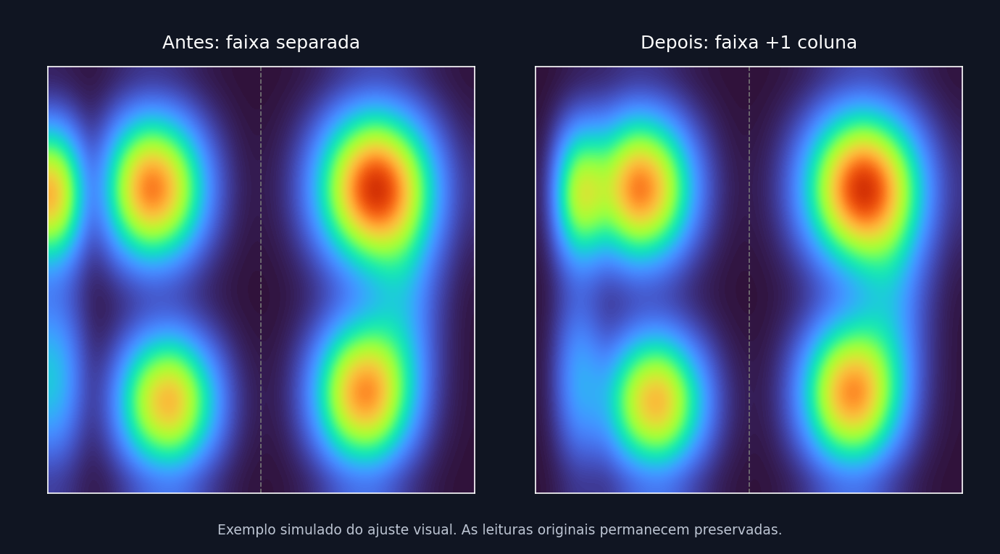

# Alinhamento visual da faixa esquerda — 08/10/2026

**REVERTIDO em 08/10/2026 a pedido do usuário: o resultado na plataforma não foi adequado.** Este documento conserva o histórico da tentativa; o controle e o reposicionamento descritos abaixo foram removidos. Consulte [registro do rollback](ROLLBACK_FAIXA_ESQUERDA.md).

O usuário relatou uma faixa na borda esquerda que desaparece sem carga e acompanha a região pressionada, mas aparece afastada do pé. Foi solicitado deslocá-la para a direita por software na visualização. A origem física da discrepância não foi comprovada.

O ajuste inicial é de **uma coluna para a direita**. Em Ajustes avançados do mapa, **Alinhamento da faixa esquerda** permite escolher de 0 a 3 colunas; 0 desativa. A primeira coluna é inserida na posição escolhida e as colunas intermediárias recuam uma posição. Não há soma, duplicação, descarte ou interpolação de leituras adicionais. O centro e a metade direita mantêm suas posições.

O alinhamento é aplicado antes da interpolação, somente na apresentação dos mapas REAL. Leituras brutas, tara, matriz orientada, média temporal, métricas e calibração física continuam usando as coordenadas originais. O marcador desenhado passa a ser o centro da distribuição apresentada e é identificado como **CoP visual**; as métricas e trajetórias preservam o CoP original.

O parâmetro é persistido nas preferências e nas configurações de novos exames. Exames antigos sem esse parâmetro preservam a apresentação original. A comparação respeita o alinhamento registrado em cada exame mesmo com escala comum. PNG, prévia de relatório e PDF usam o mesmo ajuste. A simulação do aplicativo não recebe o reposicionamento.

Os visualizadores antigos `heatmap.py` e `mapa_calor.py`, na pasta `teste arduino`, receberam o mesmo deslocamento inicial. Com a janela do mapa focada, **[** diminui e **]** aumenta; o rodapé indica o valor. O ajuste é aplicado ao desenho depois dos cálculos originais.

A ilustração usa dados sintéticos. Ela demonstra o efeito do algoritmo e não reproduz os valores medidos na imagem do usuário. A posição correta precisa ser conferida na plataforma real após a atualização. Este ajuste visual não comprova a ordem física dos canais nem resolve por si só eventual interferência elétrica.

Validação: 185 testes frontend e 100 testes nativos aprovados (1 benchmark sintético ignorado); sintaxe dos dois visualizadores Python e preservação de todos os valores por linha conferidas. TypeScript, frontend, executável release e instalador NSIS compilados. O programa instalado permaneceu aberto e não foi substituído nesta execução.

Instalador: `src-tauri/target/visualizacao/release/bundle/nsis/BAROPRESS_0.2.11_alinhamento_x64-setup.exe`. Identidade e hashes registrados em `artifacts-alinhamento-0.2.11.json`. Feche o aplicativo antes de atualizar. Para desenvolvimento, `iniciar_baropress.bat` utiliza o código alterado.
