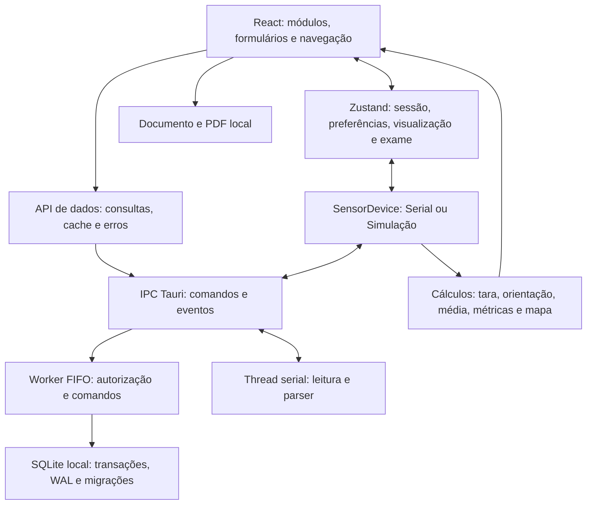

# BAROPRESS — revisão de arquitetura, UX/UI e funcionalidades

Data: 07/10/2026. Aplicativo instalado: **0.2.9**, confirmado pela versão do executável. Revisão dos fontes presentes no workspace e navegação na interface Windows/WebView2 com Computer Use.

## Resultado e alcance

A separação entre interface, aquisição, cálculos e persistência permite melhorar o produto por etapas. As prioridades são reduzir esperas de conexão que podem atrasar consultas, corrigir inconsistências de apresentação e preservar o contexto do atendimento. Depois disso, simplificar as telas e completar a gestão dos documentos.

Esta entrega é uma revisão: **nenhuma correção funcional ou mudança de layout foi aplicada**. Foram criados documentos e registros na Sprint. Prontuários, exames, questionários respondidos e backups não foram alterados pela navegação. O usuário fez o login manualmente. O aplicativo ficou aberto no Dashboard.

Foram percorridas as dez entradas do menu, as sete áreas de calibração e as quatro guias de Configurações. Isso não equivale a testar todos os controles ou concluir todas as jornadas. Tema escuro, capturas com largura aproximada de 1360/1366 px e alturas de 720/768 px. Não houve homologação em 1100×640, tema claro, leitor de tela, impressora ou outras escalas do Windows.

A conexão automática apresentou falhas repetidas na COM5, com mensagem de tempo limite do semáforo. Não houve aquisição física nesta revisão. Coleta, gravação de novo exame, exportação de PDF e restauração de backup não foram executadas. Os estados dessas operações foram revisados no código. Dados pessoais vistos na interface não foram transcritos para este relatório nem salvos como capturas.

Há uma diferença de estado entre fontes e instalação: `src/services/database/api.ts` contém um cache de consultas de 60 segundos e foi modificado depois do executável instalado. A presença desse cache nos fontes não comprova sua presença no aplicativo observado. Desempenho do pacote e dos fontes deve ser conferido com identificação do build.

**Verificação desta revisão:** `npm run typecheck` concluído sem erros. As suites de testes e benchmarks da entrega anterior não foram repetidas; seus resultados permanecem em `docs/performance/CHECKUP_0.2.9.md`.

## Arquitetura atual

| Camada | Avaliação | Próximo ajuste útil |
|---|---|---|
| Interface por funcionalidades | Módulos separados e carregamento sob demanda. Alguns componentes acumulam muitos estados e trechos de interface. | Separar etapas do exame, formulário de paciente e partes do documento; manter os cálculos fora dos componentes. |
| Navegação e sessão | Página atual em Zustand; troca de módulo desmonta a tela. Sem histórico de navegação e proteção global de alterações. | Centralizar navegação, retorno e contexto do paciente; adicionar guarda de rascunhos e operações. Um roteador completo só se trouxer benefício concreto. |
| Dados e IPC | API de dados concentra SQLite; serial usa uma abstração própria. Consultas paginadas já existem para Pacientes e Histórico. | Estender consultas limitadas aos seletores; tipar contratos compartilhados Rust/TS e padronizar erros. |
| Processamento | Tara, orientação, interpolação e métricas em serviços; parâmetros salvos por exame; visualização separada da coleta. | Preservar essa separação e incluir indicadores de qualidade temporal da amostra. |
| Backend | Autorização em Rust, transações e migrações com snapshot anterior; leitura serial em thread própria. Comandos compartilham worker FIFO. | Isolar abertura/esperas da serial da fila de dados e medir tempo de espera/execução. Não remover autorização nem serializar menos as escritas sem projeto de concorrência. |
| Persistência | SQLite local, WAL, histórico de respostas com snapshot e restauração transacional. | Snapshot demográfico e autoria do exame/documento; retenção de logs e planejamento de volume de quadros brutos. |
| Qualidade e entrega | TypeScript estrito e testes de lógica/frontend/backend existentes. Falhas de apresentação ainda escapam às suites. | Jornadas de interface com banco isolado, versão/build visível e checklist de atualização e preservação do banco. |

Não há justificativa, nesta revisão, para trocar React, Tauri ou SQLite. Também não se recomenda apagar tabelas históricas aparentemente pouco utilizadas: compatibilidade de migrações e backups precisa ser considerada.

## Correções e melhorias prioritárias

P1 = primeira etapa; P2 = etapa seguinte; P3 = evolução planejada. Esforço é relativo, não prazo fechado.

| ID | Prioridade / esforço | Evidência e impacto | Proposta e critério de aceite |
|---|---|---|---|
| PERF-01 | P1 / médio | **UI + código:** conexão COM5 falha repetidamente. `command_queue.rs` executa comandos sequencialmente; `acquisition_connect` abre a porta dentro dessa fila. Uma abertura lenta pode atrasar listas, detalhes e status mesmo com a janela respondendo. Não foi medido o tempo de cada operação. | Serial com executor próprio; tentativas com intervalo crescente e botão **Pausar tentativas**. Medir fila/consulta. Com porta ausente, inválida ou ocupada, Pacientes e Histórico devem continuar carregando normalmente. |
| DATA-01 | P1 / baixo | **Confirmado na UI:** altura cadastrada em cm aparece como **175 m** nos detalhes do exame. O documento usa 175 cm. `ExamDetailsModal.tsx:179` acrescenta `m` diretamente. | Usar o mesmo formatador em cadastro, prontuário, exame e documento. Verificar 175 cm e dado legado 1,75 m sem alterar medições do exame. Definir unidade canônica explícita no contrato de dados. |
| DATA-02 | P1 / baixo | **UI + código:** documento escreve **Tara: Ativa (Calibrada)**, embora o registro informe ausência de calibração física. | Trocar por **Compensação de zero ativa** ou **Tara aplicada**. Exibir calibração física em campo separado, somente quando houver perfil válido. Conferir também o PDF. |
| DATA-03 | P1 / médio | **Código:** detalhes recuperam altura, peso e demais dados do cadastro atual via JOIN; idade é calculada com a data de hoje. Assim, um documento antigo pode mudar após editar o cadastro ou com a passagem do tempo. | Novos exames devem guardar snapshot dos dados relevantes e idade na data da coleta. Exames antigos devem informar que os dados cadastrais históricos não foram preservados; não reconstruir dados desconhecidos. |
| FLOW-01 | P1 / médio | **Código e UI:** Sidebar troca de página diretamente. Durante coleta, sair desmonta o runtime e interrompe o exame, sem passar pelo diálogo do botão Voltar. Formulários de paciente/questionário e notas do documento usam estado local. RESULT do exame é preservado entre páginas, mas não após fechar o processo. | Guarda central para saída/fechamento, rascunho explícito e aviso durante operações. Escolhas claras: continuar, guardar rascunho ou descartar. Não permitir que retorno casual destrua trabalho. |
| QST-01 | P1 / baixo–médio | **Código:** mudar paciente ou clicar novamente em Responder limpa respostas; Novo modelo/Editar podem substituir o formulário corrente. **Atualizar lista já fica desabilitado com formulário aberto**, confirmado na UI — não é o problema pendente. | Confirmar descarte quando houver respostas/edições, fixar o paciente durante preenchimento e manter rascunho por paciente/modelo. Aceite: navegar/trocar modelo nunca perde respostas silenciosamente. |
| EXAM-01 | P1 / médio | **Código:** conclusão bloqueia ausência total de quadros; não há critério explícito de cobertura da duração ou maior intervalo sem leitura. Uma amostra curta dentro da janela pode gerar resultado. | Mostrar quadros válidos/inválidos, cobertura temporal, maior lacuna e estado da conexão. Critérios técnicos de aceitação devem ser definidos para o protocolo, sem inventar uma frequência clínica. Testar interrupção parcial, não só zero quadros. |
| SCI-01 | P1 / decisão de regra | **Código:** contato usa `valor >= threshold`; com threshold 0, zeros entram na contagem. Matriz zerada pode indicar 100% de sensores em contato, embora CoP permaneça indisponível. Pendência já registrada na auditoria anterior. | Definir e documentar regra para zero com o responsável pelo protocolo; aplicar igualmente a métricas, mapa e exame. Até a definição, tornar essa condição explícita na interface. |
| DOC-01 | P2 / médio | **UI + código:** observações no documento entram no PDF/impressão, mas não no exame salvo. A tela informa essa limitação. Autor pode aparecer como **Profissional Habilitado**, sem identificação real vinculada ao exame. | Adicionar salvar rascunho/documento, responsável e registro profissional; versões de revisão com data/autoria. Preservar amostra e parâmetros originais. Aceite: reabrir recupera texto e responsável, com histórico das revisões. |
| PERF-02 | P2 / médio | **Código:** Novo Exame consulta pacientes a cada tecla sem debounce/paginação; Agenda, Questionários e Backup usam seletores completos; Comparação carrega todos os exames para filtrar um paciente no frontend. | Busca limitada de pacientes; consulta de exames por `patientId`, período e origem no backend. Paginar históricos extensos. Aceite com base sintética grande, incluindo seletores e prontuário. |
| DATE-01 | P2 / baixo | **Código:** nascimento `YYYY-MM-DD` é passado a `new Date`, depois lido com métodos locais; pode deslocar o dia em fusos negativos. | Separar datas civis de timestamps; calcular idade com ano/mês/dia e data de referência. Conferir aniversário, virada do mês/ano e idade no dia do exame. |
| CACHE-01 | P2 / baixo–médio | **Fontes atuais:** consultas usam TTL de 60 s, deduplicação e invalidação ampla. Botões Atualizar alteram apenas revisão da tela; podem receber cache válido. | Atualizar deve forçar leitura nova. Invalidação por domínio para evitar jogar fora listas por gravações de preferências/logs. Verificar logout, restauração, mudança de dia e duas instâncias; conferir o build que contém o cache. |

## Melhorias por tela

| Área percorrida | O que observar/manter | Melhorias propostas |
|---|---|---|
| Entrada | Layout simples; recuperação local e primeiro administrador previstos no código. | Em instalação já cadastrada, trocar **Criar conta / Cadastrar usuário** por **Como obter acesso**: atualmente leva apenas à orientação para procurar o administrador. Exibir versão e instruções de recuperação acessíveis. |
| Dashboard | Indicadores e acesso ao hardware existentes. Card **Programa principal** leva ao histórico; calibração recebe destaque semelhante ao atendimento. | Nome **Início**; ação principal **Novo exame**, agenda do dia e últimos atendimentos clicáveis. Substituir **Esteira** por nome consistente da plataforma. Status de dispositivo em todas as telas. |
| Pacientes | Lista, prontuário e formulário de cadastro percorridos; busca por nome/CPF/telefone e paginação existentes. | Prontuário como centro do atendimento: Novo exame, Anamnese, Agendar e Comparar com paciente já selecionado. Cadastro rápido com campos essenciais; demais seções expansíveis. Consulta de arquivados e reativação planejada. Padronizar **Salvar paciente/Cadastrar paciente**. |
| Testes e calibração | Tapete, Diagnóstico, Ensaios, Curvas, Validação, Perfis e Protocolo abertos. Barreiras para unidades físicas devem permanecer. | Área técnica agrupada no menu; assistente **Montagem → Zero → Ensaios → Ajuste → Validação → Ativação**. Mostrar pendências e pré-requisitos junto à ação bloqueada. Substituir edição de geometria em JSON por editor de células/importação com prévia. Separar modos básico e avançado. |
| Análise | Mapa, indicadores, barra de parâmetros e painel avançado inspecionados, com dispositivo desconectado. | Nome **Análise ao vivo**. Campos numéricos além dos sliders, ajuda mais fácil de clicar e presets nomeados. Diferenciar **Limiar de contato** (altera métricas) de **Gamma/VMAX** (aparência). Distinguir taxa recebida e atualização visual. Mapa vazio deve explicar ausência de dados e oferecer caminho de conexão. |
| Novo exame | Seleção, confirmação e configurações antes do exame percorridas; nenhuma prévia/coleta iniciada. Gamma 2,70 e VMAX 1300 coincidiram com a Análise, confirmando uniformização visual nessa sessão. | Etapas visíveis **Paciente → Preparação → Coleta → Resultado → Salvar**; contexto do paciente sempre visível. Conferência de dispositivo/leitura/tara antes de coletar. Ações em rodapé fixo: na guia de ajustes é preciso rolar para chegar a Cancelar/Iniciar. Perfis de protocolo, sem novo painel de mapa em Configurações gerais. |
| Histórico de Exames | Lista, detalhes de registro salvo e duas páginas do documento percorridos. Documento integrado ao histórico deve permanecer. | Filtros por data, paciente, origem, tipo e responsável; ordenação e total de resultados. ID do exame e segundos para distinguir registros do mesmo minuto. Seleção direta de 2–4 registros para comparar, reduzindo etapas. |
| Documentos do exame | Prévia A4 e parâmetros existentes; não foi exportado PDF nem acionada impressão. | Zoom/ajustar à largura, salvar texto, identificação profissional e revisão do documento. Melhorar tamanho de textos técnicos. Conferir equivalência da prévia/PDF/impressão e usar a mesma formatação de números/unidades. |
| Comparação | Seleção de paciente e dois exames, mapas, trajetória, tabela e início dos gráficos percorridos. Mesma escala é oferecida. | Grade proporcional à quantidade: dois mapas devem ocupar duas colunas maiores; hoje ocupam metade da largura e a legenda fica apertada. Mostrar valores efetivos da escala comum, inclusive Gamma/limiar; ampliar mapas e trajetória com eixos. Datas nos gráficos, vírgula decimal e escolha dos indicadores. |
| Agenda | Semana e formulário Nova consulta abertos e cancelados sem salvar. | Filtros de profissional/status, visão por horários e resumo do dia. Atalho **Abrir atendimento** com paciente no contexto. Gestão de profissionais em Configurações/Equipe; hoje Novo profissional ocupa a barra da agenda. Rodapé fixo no modal: os botões ficaram abaixo da área inicialmente visível. |
| Questionários | Modelo de 40 perguntas e abertura de Responder inspecionados sem preencher ou salvar. | Selecionar paciente antes de abrir; grupos em etapas/accordion, progresso, validação próxima do campo, rascunho e perguntas condicionais revisadas pelo responsável do modelo. Separar catálogo de modelos do preenchimento; avisar sobre troca/descarte. |
| Configurações — Sistema | Área de conta é mostrada primeiro e o formulário de alteração de senha ocupa grande parte da tela. | Preferências do sistema primeiro; Conta e equipe como guia/seção própria, com ações recolhidas até serem solicitadas. Mostrar **Salvando/Salvo/Falha** para preferências automáticas, em vez de depender de botão manual e mensagens dispersas. |
| Configurações — Arduino | Porta/baud, modo, matriz técnica, tara e logs de sessão inspecionados. Falhas COM5 visíveis. | Mensagem curta com instrução prática e detalhes técnicos expansíveis; pausar tentativas sem precisar mudar para Simulação. Mostrar descrição do dispositivo e distinguir **Conectado** de **Recebendo quadros**. Identificação por firmware/dispositivo como evolução, pois porta COM sozinha não identifica o tapete. |
| Configurações — Backup | Tela aberta; nenhuma exportação/importação/restauração efetuada. | Mostrar último backup concluído, destino, tamanho e lembrete/configuração de cópia periódica. Planejar proteção do arquivo e gestão de chave antes de implementar cifragem. Testar restauração em banco isolado. Não confundir exportar um arquivo com ter cópia externa confirmada. |
| Configurações — Logs | Tabela carregada e eventos de sessão presentes. | Filtros de período/categoria e nomes legíveis em português; detalhes técnicos para suporte. Registrar código de erro e duração da operação sem dados pessoais. Definir retenção: mostrar 500 eventos não limita o crescimento da tabela. |

## Navegação e padrão visual sugeridos

Manter **Histórico de Exames**, sem recriar a aba Relatórios. Manter Arduino, Backup e Logs em Configurações. Manter ajustes do mapa na Análise/Novo Exame.

Organizar o menu em grupos visuais, preservando os acessos diretos:

- **Atendimento:** Início, Agenda, Pacientes, Novo exame, Histórico de Exames, Questionários, Comparação.
- **Plataforma:** Análise ao vivo, Testes e calibração.
- **Administração:** Configurações.

Paciente deve acompanhar o fluxo **Agenda/Prontuário → Anamnese → Novo exame → Histórico → Documento/Comparação**. Isso exige contexto compartilhado por paciente, não apenas esconder entradas do menu.

Unificar cabeçalhos, margens, botões, alertas, abas, campos numéricos, tabelas, estados vazios e diálogos em `components/ui`. Hoje há componentes reutilizáveis, mas muitas telas ainda têm botões e formulários próprios com alturas, textos e espaçamentos diferentes. O objetivo é tornar a ação principal previsível, com menos informação técnica na primeira camada.

Pontos gerais: textos secundários maiores, português consistente (**Prévia**, **Limiar**, **Suavização**), números pt-BR, ações sempre acessíveis em telas baixas, status além da cor, tooltips acessíveis por teclado e setas nas tablists. Manter suporte a foco visível/redução de movimento já existente. Validar contraste e tema claro em ensaio separado; esta revisão não mediu conformidade de acessibilidade.

## Evolução técnica posterior

1. Instrumentar tempo de fila, consulta, render e uso de memória. Comparar hardware ausente/conectado/leitura ativa e bases pequenas/grandes. Otimizações de interpolação anteriores devem ser preservadas e não substituem perfil do aplicativo completo.
2. Executores separados para banco e I/O serial, com autorização preservada; comandos limitados e observabilidade. Backup/calibração pesada também precisa de estado de progresso e controle de espera. Evitar criar threads arbitrárias que disputem o mesmo mutex do SQLite.
3. Extrair etapas e hooks de componentes extensos. `NewExamPage` tem 759 linhas; `PatientDetails`, `PatientForm` e `ReportViewer` têm mais de 500. O tamanho é sinal de manutenção, não prova de lentidão. Priorizar mudança que reduza acoplamento e facilite testar jornadas.
4. Padronizar DTOs, validações, unidades e versões de cálculo; separar resultado original, aparência e documento revisado. Validar limites em Rust e TS com os mesmos contratos, mantendo migrações compatíveis.
5. Completar papéis de equipe e vínculo com o responsável. A autorização atual diferencia admin em operações específicas; não há uma matriz detalhada de permissões por atividade. Gestão da clínica, dados do cabeçalho e reativação de cadastros são evolução de produto.
6. Planejar cifragem/recuperação de chave, retenção e volume de backups. Login protege acesso pela aplicação, mas não cifra SQLite/JSON. Decisão e ensaio de migração com cópia devem preceder alterações desse tipo.
7. Testes de interface com dados sintéticos: preencher/sair/voltar; paciente → exame → reabertura → documento; comparação em mesma escala; erro de serial com navegação; restauração em instalação isolada. Incluir 1100×640, 1366×768, tema claro/escuro e escala do Windows.
8. Atualizar diagrama/documentação atuais: referências antigas a Aquisição/Relatórios como abas independentes e percentuais históricos de cobertura devem permanecer identificadas por versão. Registro de progresso precisa distinguir navegação, teste de gravação e homologação física.

## Ordem de execução proposta

| Etapa | Entrega concreta | Como conferir |
|---|---|---|
| 1 — Confiabilidade | PERF-01, unidades/tara/datas e regra explícita para zero | Porta com falha + navegação; unidades iguais em todas as telas; datas nos limites; matriz zerada conforme regra definida. |
| 2 — Preservação do atendimento | Guarda de saída, rascunhos, contexto do paciente e qualidade da coleta | Sair/voltar/fechar em cada formulário; perda parcial de quadros; nenhuma perda silenciosa. |
| 3 — UX/UI | Início, grupos de navegação, rodapés fixos, parâmetros precisos e comparação ampliada | Jornadas com poucos cliques, dois/quatro exames, resolução mínima e ambos os temas. |
| 4 — Histórico/documentos | Snapshots, responsável, texto persistido e versões | Alterar cadastro não muda exame novo já salvo; reabrir conserva texto/autoria; PDF e impressão equivalentes. |
| 5 — Escala/manutenção | Seletores limitados, cache com atualização explícita, logs, contratos e componentes | Base sintética grande, medidas de fila/render e testes integrados isolados. |

Cada etapa deve gerar um TXT na Sprint com objetivo, implementação, testes, limitações e próximos passos. As etapas acima são **propostas**, não entregas concluídas nem autorização implícita para migrar dados.

## Evidências centrais no código

- `src-tauri/src/command_queue.rs:11`, `src-tauri/src/lib.rs:45` e `src-tauri/src/acquisition.rs:173`: fila/autorização/abertura de porta.
- `src/services/acquisition/automaticConnection.ts:19`: nova tentativa após 3000 ms, sem intervalo crescente.
- `src/features/exams/ExamDetailsModal.tsx:179`: unidade incorreta da altura.
- `src/features/reports/ReportViewer.tsx:432` e `reportPdfGenerator.ts:460`: tara chamada de calibrada.
- `src-tauri/src/exams.rs:486`: dados cadastrais atuais no exame reaberto.
- `src/features/patients/patientUtils.ts:54`: idade com data atual e parser de data civil.
- `src/components/Sidebar.tsx:37`, `src/stores/session.ts:42`, `src/features/exams/examRuntime.ts`: navegação direta e cancelamento na desmontagem.
- `src/features/questionnaires/QuestionnairesPage.tsx:38`, `:104`, `:114`: reset de respostas e proteção já existente do botão Atualizar.
- `src/features/exams/examStore.ts:239`, `src/services/baropodometry/metrics.ts`: ausência total de quadros e regra de contato.
- `src/features/reports/ReportViewer.tsx:39`: observações em estado local.
- `src/features/comparison/ComparisonPage.tsx:78` e `comparisonUtils.ts`: lista completa e escala comum.
- `src/services/database/api.ts:32`: cache de 60 segundos nos fontes atuais.
- `src-tauri/src/support.rs`: gravação de logs sem política de retenção implementada nesse fluxo.

Registro associado: `Sprint/05_Historico/2026-10-07_10_revisao_arquitetura_ux_funcionalidades.txt`.

## Correções posteriores

Em 07/10/2026, a versão 0.2.10 implementou parte das melhorias acima.
Esta revisão continua sendo o registro do estado 0.2.9; evidências e linhas
de código aqui refletem aquele momento. Consulte
[correções 0.2.10](../corrections/CORRECOES_0.2.10.md) e
[pendências vigentes](../../Sprint/04_Futuro/PENDENCIAS_POS_CORRECOES_0.2.10.txt)
para identificar o que foi entregue e o que ainda precisa de homologação/definição.
